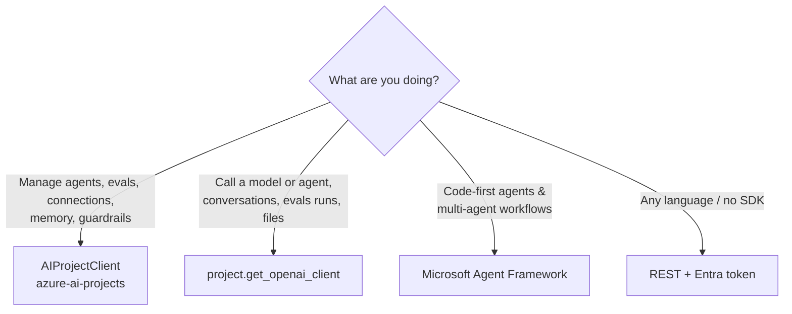

# Core concepts

A quick vocabulary for the labs. Each term links to the lab where you use it.

## The building blocks

| Concept | What it is | Lab |
|---|---|---|
| **Foundry resource** | The Azure resource (`Microsoft.CognitiveServices/accounts`, kind `AIServices`) that hosts models, guardrails and projects | [Setup](setup.md) |
| **Project** | A workspace inside the resource for agents, evaluations, connections and files. Has its own endpoint and managed identity | [M1](modules/01-first-inference.ipynb) |
| **Deployment** | A model made callable under a name (e.g. `gpt-5.4-mini`), with a SKU and capacity | [M1](modules/01-first-inference.ipynb) |
| **Responses API** | The OpenAI-compatible API used for model calls *and* agents: text, tools, streaming, structured output | [M1](modules/01-first-inference.ipynb) |
| **Conversation** | A server-side thread of items (messages, tool calls) that responses can append to | [M2](modules/02-your-first-agent.ipynb) |
| **Prompt agent** | A named, **versioned** definition: model + instructions + tools + guardrails. Immutable per version | [M2](modules/02-your-first-agent.ipynb) |
| **Agent endpoint** | The stable URL for an agent, with a version selector that decides which version serves traffic | [M2](modules/02-your-first-agent.ipynb) |
| **Tool** | Something the model can call: built-in (code interpreter, web search, AI Search, MCP, memory) or your own function | [M3](modules/03-tools-and-function-calling.ipynb) |
| **Connection** | A project-level, secret-free link to another resource (Search, App Insights, MCP servers…) | [M4](modules/04-grounding-rag.ipynb) |
| **Memory store** | Long-term, per-scope (per-user) facts and summaries that agents can search and update | [M6](modules/06-agent-memory.ipynb) |
| **Microsoft Agent Framework** | Open-source SDK for code-first agents and multi-agent **workflows** — runs anywhere, uses Foundry models | [M3](modules/03-tools-and-function-calling.ipynb), [M7](modules/07-multi-agent-orchestration.ipynb) |
| **Workflow agent** | A declarative (YAML) multi-agent workflow hosted by Foundry | [M7](modules/07-multi-agent-orchestration.ipynb) |
| **Evaluation / run** | An eval defines data shape and **testing criteria** (graders); a run scores a dataset or a live target | [M9](modules/09-evaluation.ipynb) |
| **Evaluation rule** | Triggers an eval automatically on events such as *response completed* (continuous evaluation) | [M10](modules/10-observability-tracing.ipynb) |
| **Guardrail (RAI) policy** | Content filters, prompt shields, protected-material checks and blocklists applied to deployments or agents | [M11](modules/11-guardrails.ipynb) |
| **Red-team run** | Automated adversarial testing of an agent, driven by a risk **taxonomy** and attack strategies | [M12](modules/12-red-teaming.ipynb) |
| **Fine-tuning job** | Trains a custom version of a base model on your JSONL data | [M14](modules/14-fine-tuning-distillation.ipynb) |

## Which client do I use?

* `AIProjectClient(endpoint, credential)` — the **control plane** for your project.
* `project.get_openai_client()` — a standard `openai.OpenAI` client pointed at your project. Pass
  `agent_name=` to get one bound to an agent endpoint.
* Agent Framework's `FoundryChatClient` — a chat client for Agent Framework agents backed by Foundry models.

## Authentication

The template **disables API keys**. Everything uses **Microsoft Entra ID** via `DefaultAzureCredential`
(your `az login` locally, a managed identity in Azure). The template assigns you:

* **Foundry User** — use models, agents and evaluations.
* **Foundry Project Manager** — create agents, connections and deployments in the project.
* **Search Index Data Contributor** — build the M4 index.
* **Log Analytics Reader** — query traces in M10.
