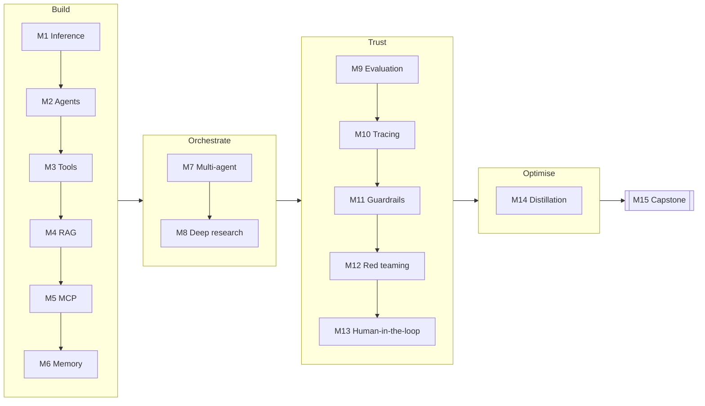

---
hide:
  - navigation
---

# Microsoft Foundry Hands-on Workshop

**Build, ground, evaluate, secure and observe AI agents on Microsoft Foundry** — in 15 hands-on notebook labs
that run against your own Azure subscription, organised as an [8-week course](eight-week-course.md).

Every lab uses the **current** Foundry stack: the `azure-ai-projects` 2.x SDK, the OpenAI-compatible
**Responses API**, versioned **prompt agents**, and **Microsoft Agent Framework** for code-first orchestration.
Each lab was run end-to-end against a live project before publishing.

[Get set up :material-arrow-right:](setup.md){ .md-button .md-button--primary }
[Jump to the labs :material-flask:](modules/01-first-inference.ipynb){ .md-button }

## What you'll build

| Week | # | Lab | You'll learn to… |
|---|---|---|---|
| 1 | 1 | [First inference](modules/01-first-inference.ipynb) | Call models with the Responses API, stream, use structured outputs and embeddings |
| 1 | 2 | [Your first agent](modules/02-your-first-agent.ipynb) | Create versioned prompt agents, hold conversations, roll forward and back |
| 2 | 3 | [Tools & function calling](modules/03-tools-and-function-calling.ipynb) | Use code interpreter, write a function-calling loop, try Agent Framework tools |
| 2 | 4 | [Grounding with Azure AI Search](modules/04-grounding-rag.ipynb) | Build a hybrid index and ground an agent with citations |
| 3 | 5 | [MCP tools](modules/05-mcp-tools.ipynb) | Connect agents to remote MCP servers with tool allow-lists and approvals |
| 3 | 6 | [Agent memory](modules/06-agent-memory.ipynb) | Give agents long-term, per-user memory |
| 4 | 7 | [Multi-agent orchestration](modules/07-multi-agent-orchestration.ipynb) | Sequential, concurrent and handoff patterns; declarative workflows |
| 4 | 8 | [Deep research](modules/08-deep-research.ipynb) | Plan → parallel web research → gap check → cited report |
| 5 | 9 | [Evaluation](modules/09-evaluation.ipynb) | Score datasets and agent versions with built-in and custom graders |
| 5 | 10 | [Observability & tracing](modules/10-observability-tracing.ipynb) | OpenTelemetry → App Insights, KQL, continuous evaluation |
| 6 | 11 | [Guardrails](modules/11-guardrails.ipynb) | Content filters, prompt shields, blocklists and PII redaction |
| 6 | 12 | [Red teaming](modules/12-red-teaming.ipynb) | Attack your own agent with the AI Red Teaming Agent |
| 7 | 13 | [Human-in-the-loop & REST](modules/13-human-in-the-loop-and-rest.ipynb) | Approval gates for risky tools; the raw REST API |
| 7 | 14 | [Fine-tuning & distillation](modules/14-fine-tuning-distillation.ipynb) | Teacher → student distillation with a fine-tuned small model |
| 8 | 15 | [Capstone](modules/15-capstone.ipynb) | Combine everything and ship behind an evaluation gate |

## Who it's for

Developers, architects and community leaders who know some Python and want a practical, current tour of
Microsoft Foundry. No prior Foundry experience is needed. Facilitators can find the weekly plan in the
[8-week course](eight-week-course.md) and run-of-show notes in the [facilitator guide](facilitator-guide.md).

## How it works

1. **One command provisions everything** — `azd up` deploys a Foundry resource and project, models, Azure AI
   Search, Application Insights, a guardrail policy and all role assignments.
2. **Each lab is a self-contained notebook.** Run them in order, or jump to the one you need.
3. **Clean up with one command** — `azd down --purge`.

!!! info "Credit"
    The learning path is inspired by [monuminu/foundry-workshop](https://github.com/monuminu/foundry-workshop).
    This is an independent rewrite for the current Foundry platform and SDKs.
