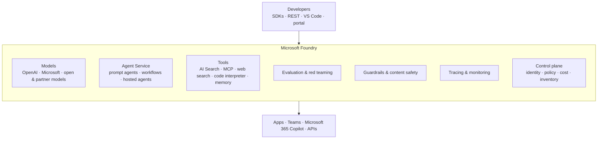

# What is Microsoft Foundry?

**Microsoft Foundry** is Azure's platform for building, evaluating, deploying and governing AI applications
and agents. It brings models, agents, tools, data, safety and observability together behind a single resource,
a single portal ([ai.azure.com](https://ai.azure.com)) and a single set of SDKs.

## The pieces

| Area | What it gives you | Labs |
|---|---|---|
| **Models** | A catalog of frontier and open models, deployed as serverless or provisioned endpoints | M1, M14 |
| **Agent Service** | Hosted, versioned agents with server-side conversations, tools and endpoints | M2–M8, M13, M15 |
| **Tools & knowledge** | Grounding (Azure AI Search, web), MCP, code execution, long-term memory | M3–M6, M8 |
| **Evaluation** | Built-in and custom graders, agent-target evals, continuous evaluation, red teaming | M9, M10, M12 |
| **Safety** | Guardrail policies: harm filters, prompt shields, protected material, blocklists | M11 |
| **Observability** | OpenTelemetry tracing to Application Insights, monitoring dashboards | M10 |
| **Control plane** | Inventory, policy and governance for agents and models across the organisation | [Control plane](03-control-plane-and-governance.md) |

## Foundry and Agent Framework

They're complementary:

* **Foundry Agent Service** *hosts* agents: you define them (instructions, tools, guardrails), Foundry runs them
  behind an endpoint and stores conversations.
* **Microsoft Agent Framework** is an open-source SDK (Python and .NET) for *writing* agents and multi-agent
  workflows in code. It can call Foundry models and Foundry-hosted agents, and its workflows can be hosted on
  Foundry too.

The labs use both: hosted prompt agents for most scenarios, Agent Framework where orchestration logic belongs in
your code (M3, M7, M13).

## What changed since the "Azure AI Foundry" era?

If you used earlier workshops, these are the biggest differences you'll notice:

| Before | Now |
|---|---|
| Hub + project resources | A single **Foundry resource** with **projects** as child resources |
| Assistants-style threads / runs | The **Responses API** + **conversations** |
| Agents identified by ID, mutable | **Named, versioned** agents with an **agent endpoint** and version selector |
| Separate evaluation SDK flows | Evaluations through the OpenAI-compatible **evals** API, with built-in Foundry evaluators |
| Semantic Kernel / AutoGen | **Microsoft Agent Framework** |
| API keys everywhere | **Entra ID** by default, keys disabled |
