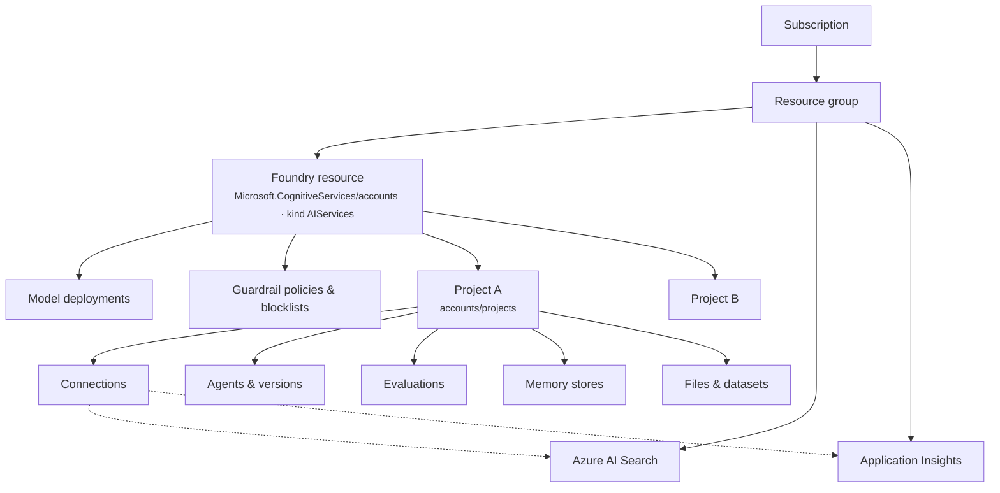

# Architecture & projects

## Resource model

* The **Foundry resource** owns the shared, billable things: **deployments**, **guardrail policies**, network
  and encryption settings.
* **Projects** are isolated workspaces for a team or application. Each has its own endpoint
  (`https://<resource>.services.ai.azure.com/api/projects/<project>`), managed identity, agents, evaluations,
  files and connections. Projects share the resource's deployments.
* **Connections** let a project use other resources (Search, App Insights, storage, MCP servers, other model
  endpoints) without putting secrets in your code.

## Endpoints you'll meet

| Endpoint | Used for |
|---|---|
| `https://<resource>.services.ai.azure.com/api/projects/<project>` | `AIProjectClient`, agent and eval management (REST: `?api-version=v1`) |
| `…/api/projects/<project>/openai/v1/` | OpenAI-compatible responses, conversations, evals, files, fine-tuning |
| `…/api/projects/<project>/agents/<name>/endpoint/protocols/openai/` | An agent's own endpoint (`get_openai_client(agent_name=…)`) |
| `https://<resource>.services.ai.azure.com/openai/v1/` | Resource-level OpenAI API (the labs use it for **embeddings**) |
| `https://<resource>.cognitiveservices.azure.com/` | Azure AI services such as Language (PII detection in M11) |

## Identity and access

The template disables local (key) auth. Two identities matter:

* **You** — granted *Foundry User* and *Foundry Project Manager* on the resource, plus data roles on Search and
  Log Analytics.
* **The project's managed identity** — what Foundry uses when an agent calls *another* resource on your behalf
  (e.g. querying Azure AI Search in M4). It needs its own roles on those resources; the template assigns them.

## Choosing how to split projects

| Pattern | When |
|---|---|
| One project per **application** | Most common. Clear ownership, separate evals and traces |
| One project per **environment** (dev/test/prod) | When you need hard isolation between stages but share deployments |
| Separate **resources** per environment | When network, encryption or quota must differ between stages |

For this workshop, one resource with one project is all you need.
