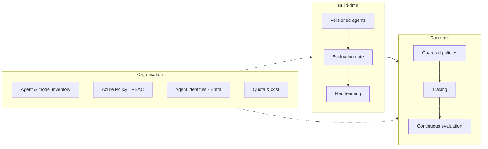

# Control plane & governance

Once agents leave the lab, the questions change: *Which agents exist? Who owns them? What can they reach? Are
they safe, and what do they cost?* Foundry answers these with a set of governance capabilities often called the
**control plane**.

## What the workshop covers

| Concern | Capability | Lab |
|---|---|---|
| Change management | Immutable agent **versions**; endpoint version selector for roll forward / back | M2 |
| Quality gates | Agent-target **evaluations** comparing versions before release | M9, M15 |
| Safety | **Guardrail policies** on deployments and agents; prompt shields; blocklists | M11 |
| Adversarial testing | **AI Red Teaming Agent** | M12 |
| Accountability | **Human approval** for consequential tool calls | M13 |
| Visibility | **Tracing** with GenAI semantic conventions, **continuous evaluation**, monitoring | M10 |
| Least privilege | Keyless **Entra ID** auth, built-in Foundry roles, project managed identity | Setup |

## Beyond the workshop

* **Inventory and fleet view** — the portal's operate / admin views list agents, models and their health across
  projects.
* **Azure Policy** — restrict which models can be deployed, require guardrail policies, enforce network
  isolation and disable key auth across a subscription.
* **Network isolation** — private endpoints and a bring-your-own virtual network for agent tools.
* **Agent identity** — agents get Microsoft Entra identities so their access can be governed like any workload.
* **Publishing** — share agents to Microsoft 365 Copilot and Teams from the portal.

!!! tip "A practical baseline"
    Keys off · guardrail policy on every deployment · an evaluation gate in CI · tracing on in every environment ·
    continuous evaluation on production agents · human approval on any tool that changes data or spends money.
