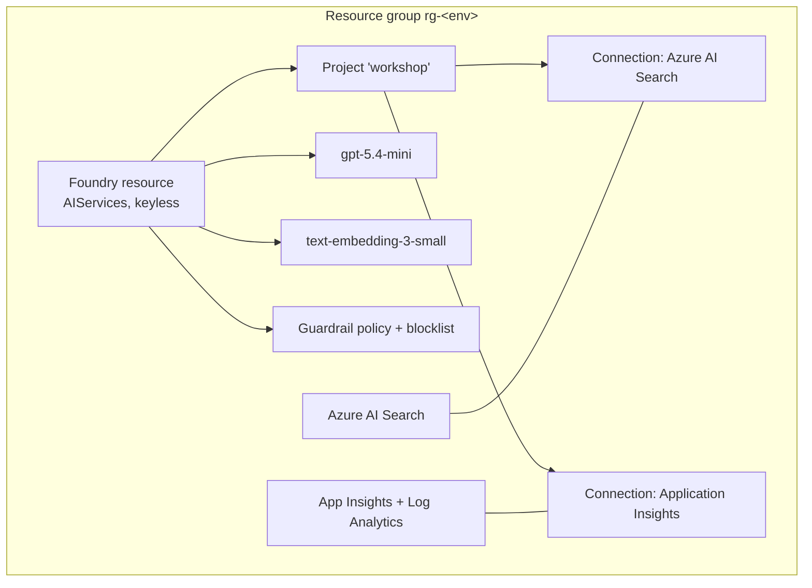

# Setup

You need an Azure subscription and a Python environment. Choose **GitHub Codespaces** (nothing to install) or a
**local** setup.

## Prerequisites

| | |
|---|---|
| Azure subscription | With permission to create resource groups and **role assignments** (Owner, or Contributor + User Access Administrator) |
| Model quota | ~100K TPM for `gpt-5.4-mini` and `text-embedding-3-small` (GlobalStandard) in your region |
| Tools | [Azure Developer CLI](https://aka.ms/azd-install) (`azd`), [Azure CLI](https://aka.ms/installazurecli) (`az`), Python 3.10+ , Git |

!!! tip "Codespaces / dev container"
    Open the repo in **GitHub Codespaces** or a **VS Code dev container** and all tools and Python packages are
    installed for you. Skip to [Provision](#2-provision-azure-resources).

## 1. Get the code and install packages

```bash
git clone https://github.com/nonsoUdechukwu/foundry-workshop.git
cd foundry-workshop
python -m venv .venv
source .venv/bin/activate        # Windows: .venv\Scripts\activate
pip install -r requirements.txt
```

## 2. Provision Azure resources

```bash
az login
azd auth login
azd up
```

`azd up` asks for an environment name, subscription and region, then deploys:



When it finishes, a hook writes all settings to **`.env`** in the repo root. Every notebook reads that file.

!!! note "Supported regions"
    The template allows `swedencentral` (default, recommended), `eastus2`, `northcentralus`, `westus3`,
    `francecentral` and `australiaeast`. M14 fine-tunes `gpt-4.1-nano`; check
    [fine-tuning availability](https://learn.microsoft.com/azure/ai-foundry/openai/concepts/models#fine-tuning-models)
    if you pick a region other than Sweden Central.

!!! warning "Azure AI Search capacity"
    If deployment fails with **InsufficientResourcesAvailable** for Search, put Search in a nearby region and
    re-run: `azd env set AZURE_SEARCH_LOCATION northeurope && azd up`.

### Without azd

```bash
az deployment sub create -n foundry-workshop -l swedencentral -f infra/main.bicep \
  -p environmentName=foundry-workshop principalId=$(az ad signed-in-user show --query id -o tsv)
```

Then copy the outputs into `.env` (see [`.env.example`](https://github.com/nonsoUdechukwu/foundry-workshop/blob/main/.env.example)):

```bash
az deployment sub show -n foundry-workshop --query properties.outputs -o json \
  | python -c "import json,sys; [print(f'{k}={v[\"value\"]}') for k,v in json.load(sys.stdin).items()]" > .env
```

## 3. Check it works

Open `docs/modules/01-first-inference.ipynb` in VS Code or Jupyter, select the `.venv` kernel and run the first
cells. If you get a **401/403**, wait a few minutes — new role assignments can take time to propagate — then try
again. See [Troubleshooting](troubleshooting.md) for other issues.

!!! info "Where are the notebooks?"
    The notebooks live in `docs/modules/`. They're generated from the Python sources in `labs/` — edit those if
    you want to contribute (see `CONTRIBUTING.md`).

## Cost

Everything is pay-as-you-go except **Azure AI Search (Basic)**, which bills hourly while it exists. M12 (red
teaming) and M14 (fine-tuning) generate the most model usage. **[Clean up](cleanup.md)** when you're done.
